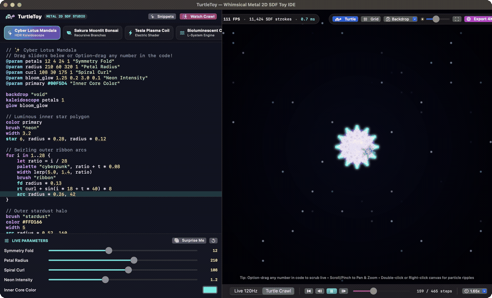
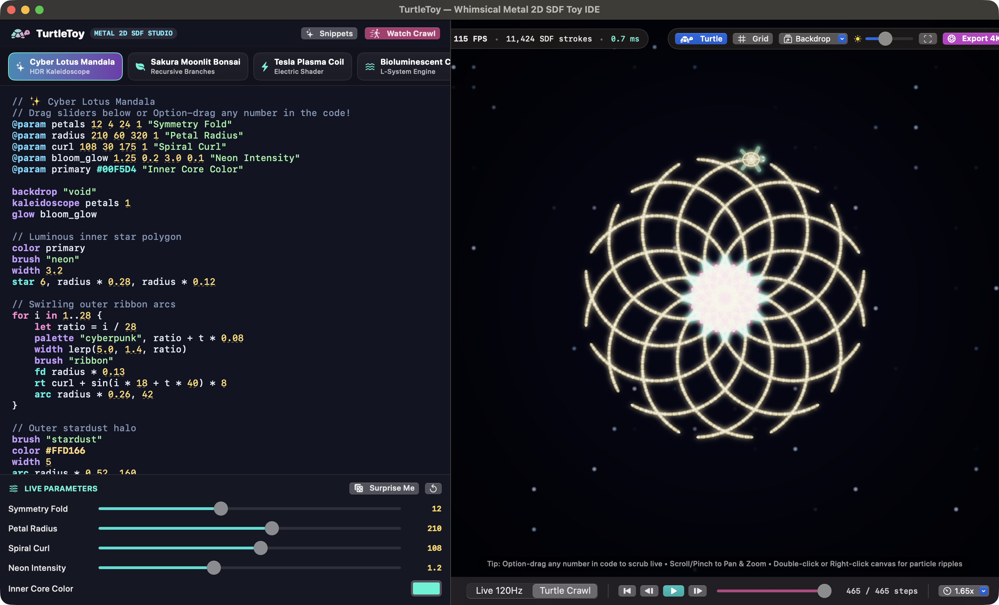
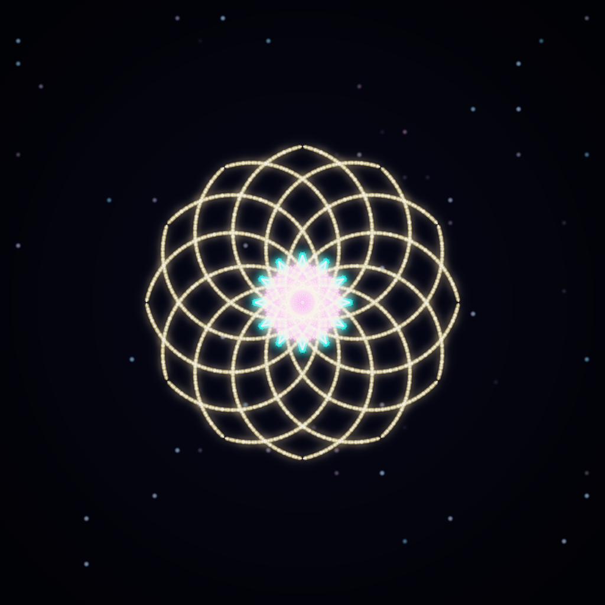
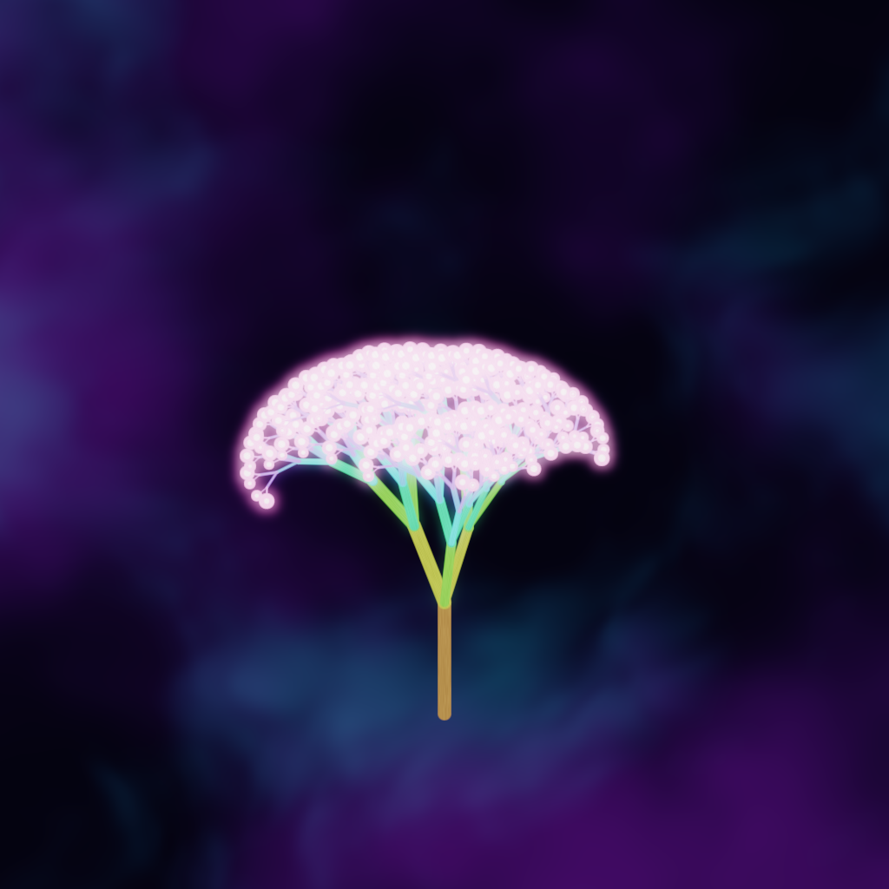
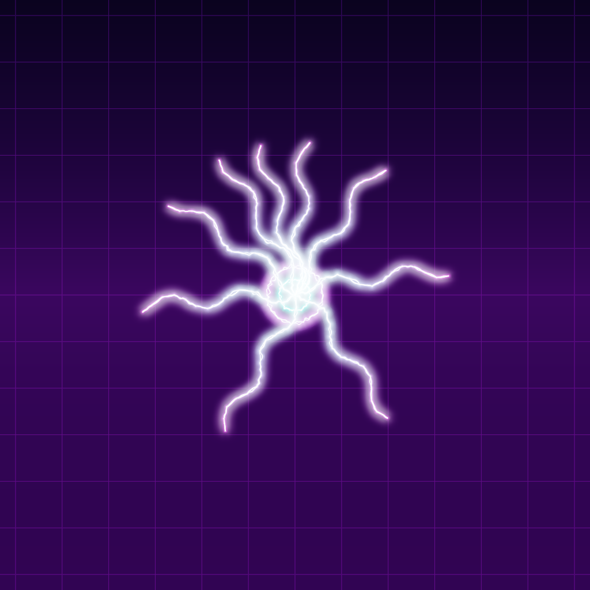
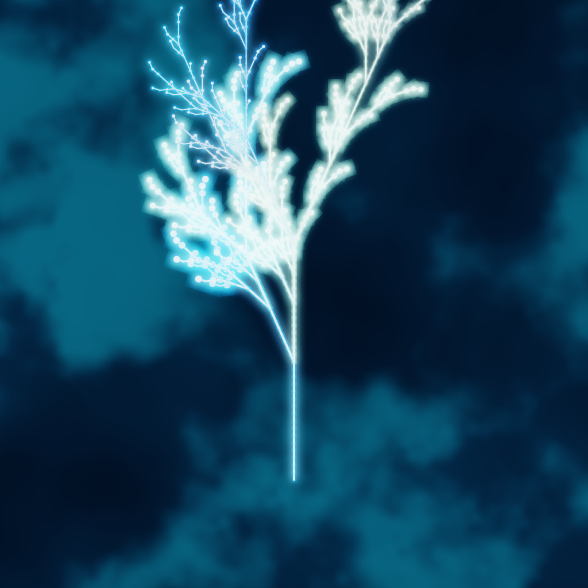
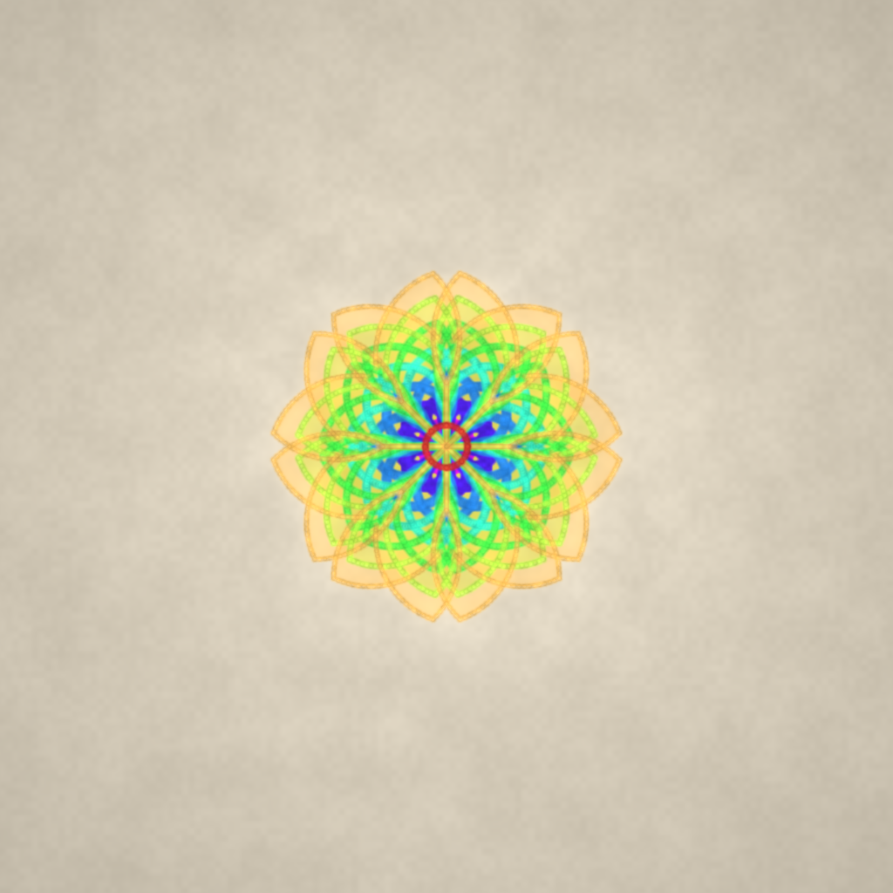
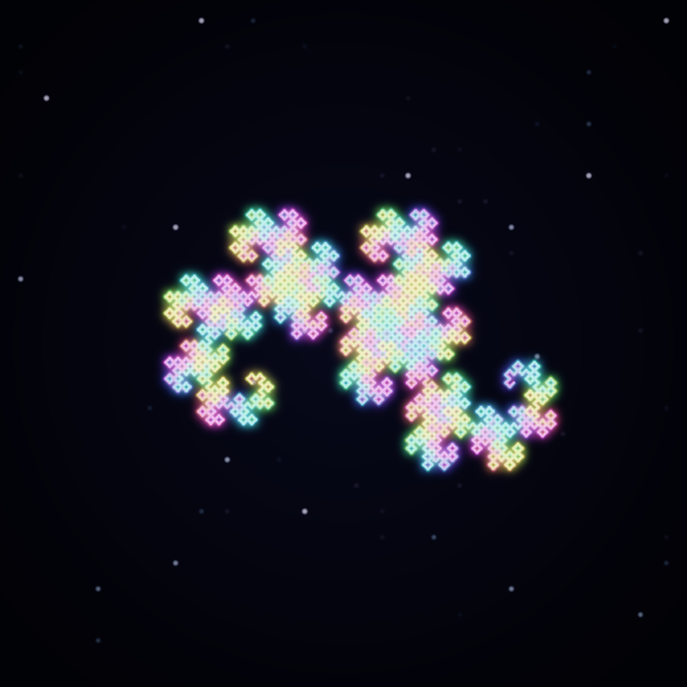
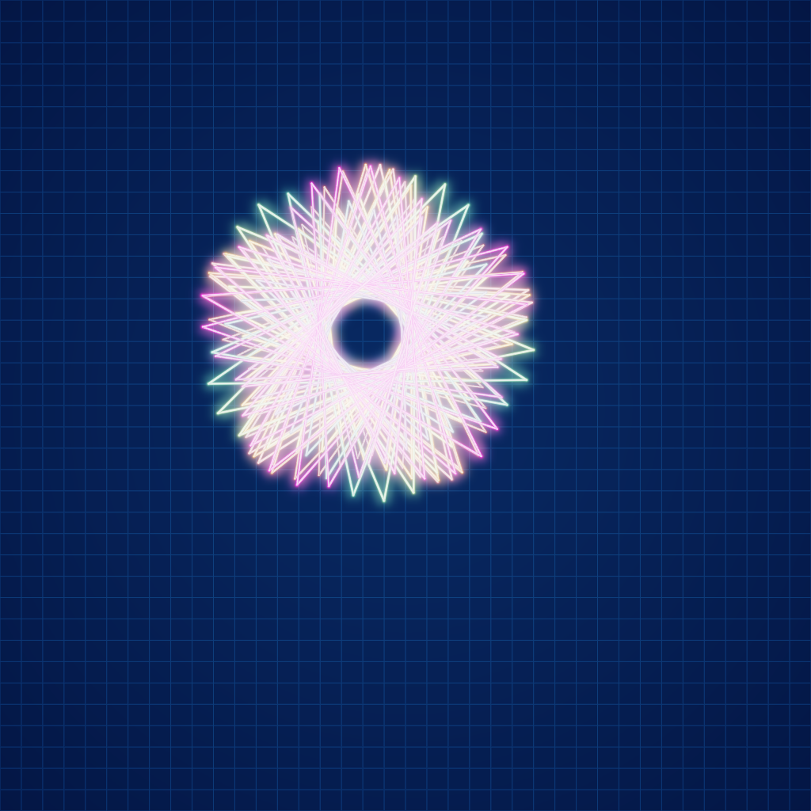
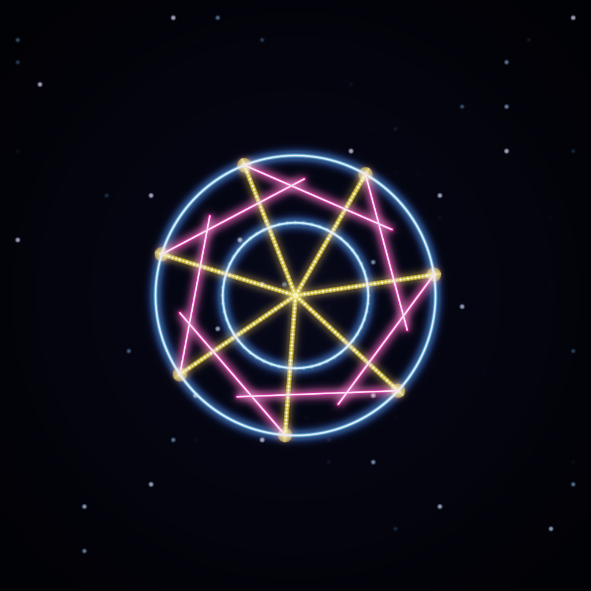

# 🐢✨ TurtleToy

**A macOS creative-coding toy for turtle graphics — powered by Swift 6 and a 120Hz Metal 2D Signed Distance Field (SDF) + HDR Bloom engine.**

[](LICENSE)
[-FF6AC1.svg)](Package.swift)
[](Package.swift)
[](docs/ARCHITECTURE.md)

**TurtleToy** reimagines classic Logo turtle graphics for modern Apple Silicon GPUs — with **zero web views or Electron**. Every stroke is rendered analytically as a Signed Distance Field (SDF) capsule in 16-bit floating-point (`RGBA16Float`) HDR space with procedural shader brushes, separable Gaussian bloom, GPU particle bursts, L-systems, kaleidoscopic symmetry, and live 120Hz number scrubbing.



<details>
<summary><b>📸 View Full-Resolution Retina IDE Screenshot (2720×1680)</b></summary>
<br>



</details>

---

## 🎨 Showcase Gallery (Rendered Directly by TurtleToy's Metal Pipeline)

| Cyber Lotus Mandala (`neon` + `ribbon` + `stardust`) | Sakura Moonlit Bonsai (`branch` + `calligraphy`) |
| :---: | :---: |
|  |  |
| **Tesla Plasma Coil (`electric` + `spawn`)** | **Bioluminescent Coral (`lsystem` + `ocean`)** |
|  |  |
| **Aquarelle Botanical Rose (`watercolor` + `parchment`)** | **Laser Dragon Curve (`rainbow` fractal)** |
|  |  |
| **Harmonic Laser Spirograph (`laser` + `blueprint`)** | **Celestial Star Weaver (`stardust` + `symmetry`)** |
|  |  |

---

## ✨ Key Features

### 🖌️ 4-Pass Metal 2D SDF + HDR Rendering Engine
- **Razor-Sharp Analytical SDF Geometry**: Every segment and arc is evaluated per-pixel with `fwidth` screen-space derivatives — infinitely crisp at any zoom (`0.15x` to `14x`).
- **8 Procedural Shader Brushes**:
  - `neon` — White-hot inner core + saturated HDR plasma aura
  - `laser` — Coherent beam with chromatic edge dispersion
  - `watercolor` — Multi-octave FBM noise edge deckle + coffee-ring pigment pooling
  - `calligraphy` — Chisel-nib thickness modulation based on stroke angle + bristle texture
  - `rainbow` — Continuous spectral prism along cumulative path length
  - `electric` — Animated dual-strand high-voltage jagged lightning arcs
  - `stardust` — Twinkling 4-point star glints & constellation beads
  - `ribbon` — 3D cylindrical satin shading with specular highlights & iridescent rim
- **6 Procedural Shader Backdrops**: Cosmic Void starfield (`void`), Outrun Synthwave Grid (`synthwave`), Warm Watercolor Paper (`parchment`), Bioluminescent Deep Ocean caustics (`ocean`), Aurora Nebula (`nebula`), and Architect Blueprint (`blueprint`).
- **GPU Particle System & Ripples**: Sparks, embers, and stardust fly off active turtle pens; double-click or right-click anywhere on the canvas to trigger interactive energy ripples and particle supernovas.

### 🐢 Expressive Custom TurtleToy Language
- **Classic Logo Ergonomics**: `fd`, `bk`, `lt`, `rt`, `pu`, `pd`, `home`, `goto`, `move`, `seth`, `arc`, `circle`, `dot`, `polygon`, `star`, `beginfill` / `endfill`.
- **Effortless Fractals & Multi-Turtle Concurrency**:
  - `branch { ... }` — Automatically pushes and restores the turtle's pose, pen width, color, and brush at the end of the block.
  - `spawn { ... }` — Spawns an independent sub-turtle from the current position.
  - `lsystem { ... }` — Built-in Lindenmayer system string rewriter with custom `draw "<symbol>" { ... }` blocks.
  - `symmetry N` & `kaleidoscope N, 1` — Instant rotational and mirror reflection symmetry.
- **Live `@param` Sliders & "Surprise Me" Randomizer**: Declare `@param petals 12 4 24 1 "Symmetry Fold"` or `@param core #00F5D4 "Core Color"` in your code to auto-generate interactive sliders and color pickers in the IDE.

### ⚡️ Dual Execution Engine & Tactile Code Editor
- **Inline Option-Drag Number Scrubbing**: Hold **`Option (⌥)`** and drag left/right on **any number literal** inside the code editor to scrub its value live at 120fps (hold **`Option + Shift`** for fine decimal precision).
- **Live 120Hz Mode**: Instant reactive execution as you type, scrub numbers, drag sliders, or animate with the built-in time variable `t`.
- **Turtle Crawl / Scrubber Mode**: Watch the procedural SDF Cyber-Turtle crawl step-by-step with sub-segment interpolation, speed control (`0.25x` to `30x`), active source-line highlighting in the editor, and an interactive timeline scrubber.
- **One-Click 4K PNG Export**: Render high-resolution `3072×3072` artwork directly from the offscreen Metal texture.
- **Animation Export (MP4 / GIF)**: Export a Turtle Crawl or a `t`-driven time loop at up to 1080p, with size, frame rate, and duration options.
- **Save & Open Sketches**: Plain-text `.turtle` files with **`⌘N`** / **`⌘O`** / **`⌘S`** / **`⇧⌘S`**, unsaved-changes prompts, and last-session restore on launch.
- **Source Travels With Your Art**: Exported PNG, MP4, and GIF files embed the sketch's source code in their metadata.

---

## 🚀 Getting Started

### Requirements
- **macOS 14.0 (Sonoma) or newer** on Apple Silicon (M1 / M2 / M3 / M4)
- **Swift 6.0+ / Xcode Command Line Tools**

### Build & Launch the Native App Bundle
```bash
git clone https://github.com/jtdevos/turtletoy.git
cd turtletoy

# Build release binary and package TurtleToy.app
make app
open TurtleToy.app
```

### Or Run & Test Directly with Swift Package Manager
```bash
# Run the IDE in release mode
swift run -c release TurtleToy

# Run the unit test suite
swift test

# Headlessly render all 8 showcase presets to PNG via Metal
swift run -c release TurtleToy --render-showcase ./showcase_renders

# Headlessly export a preset animation (MP4 or GIF, chosen by file extension)
swift run -c release TurtleToy --export-animation sakura_bonsai_tree ./bonsai.mp4 --mode crawl
```

---

## 📖 Quick Taste of the Language

```
// 🌸 Sakura Moonlit Bonsai
@param depth 8 4 10 1 "Branch Depth"
@param spread 27 12 48 0.5 "Branch Spread"
@param blossom #FF6AC1 "Blossom Color"

backdrop "nebula"
seed 42

to tree(len, level) {
    if level <= 0 {
        color blossom
        glow 2.2
        dot 6.5
        return
    }

    let progress = 1.0 - (level / depth)
    hsl lerp(28, 330, progress), 75, lerp(38, 72, progress)
    width max(1.2, level * 1.65)
    brush "calligraphy"

    fd len

    branch {
        lt spread + sin(t * 45 + level * 30) * 6
        tree(len * 0.74, level - 1)
    }
    branch {
        rt spread * 0.88
        tree(len * 0.71, level - 1)
    }
}

move 0, -230
seth 0
tree(95, depth)
```

---

## 📚 Documentation
- **[TurtleToy Language & Creative Coding Guide (`docs/LANGUAGE_GUIDE.md`)](docs/LANGUAGE_GUIDE.md)** — Full command reference, brushes, backdrops, palettes, `@param` syntax, and L-Systems.
- **[Architecture & Metal 2D SDF Pipeline (`docs/ARCHITECTURE.md`)](docs/ARCHITECTURE.md)** — Deep dive into the lexer/parser/interpreter and the 4-pass Metal rendering pipeline.

---

## ⚖️ License

Released under the **[MIT No Attribution (MIT-0) License](LICENSE)**.  
You have complete freedom to use, modify, remix, distribute, or embed **TurtleToy** and its shaders in any personal, open-source, or commercial project with zero attribution or copyleft requirements.
